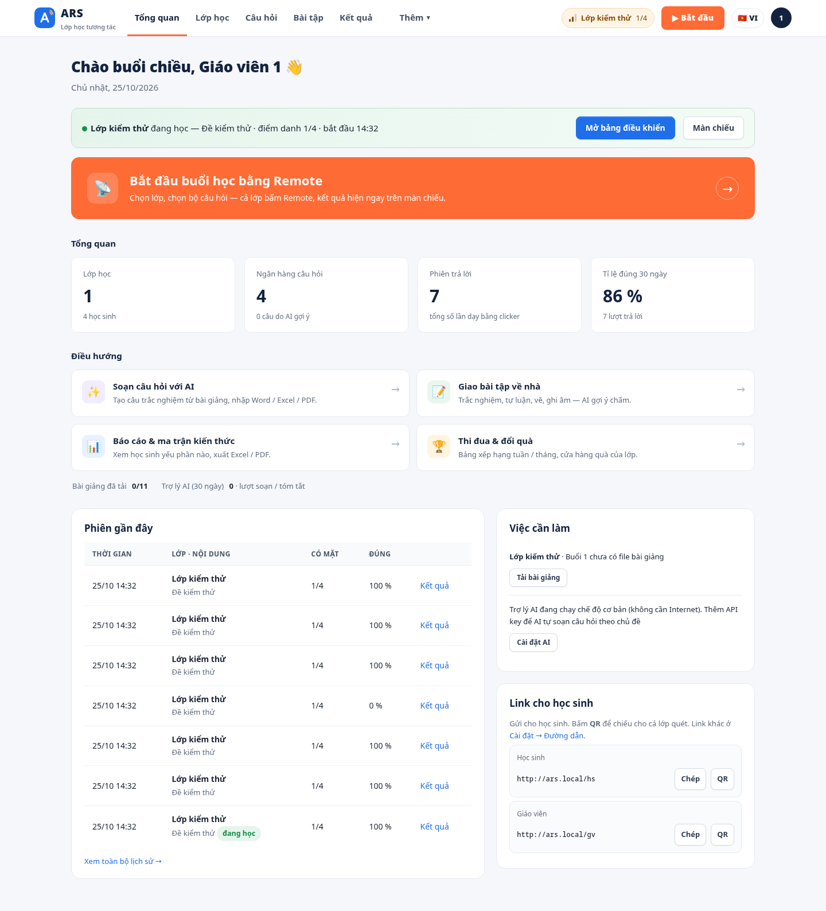
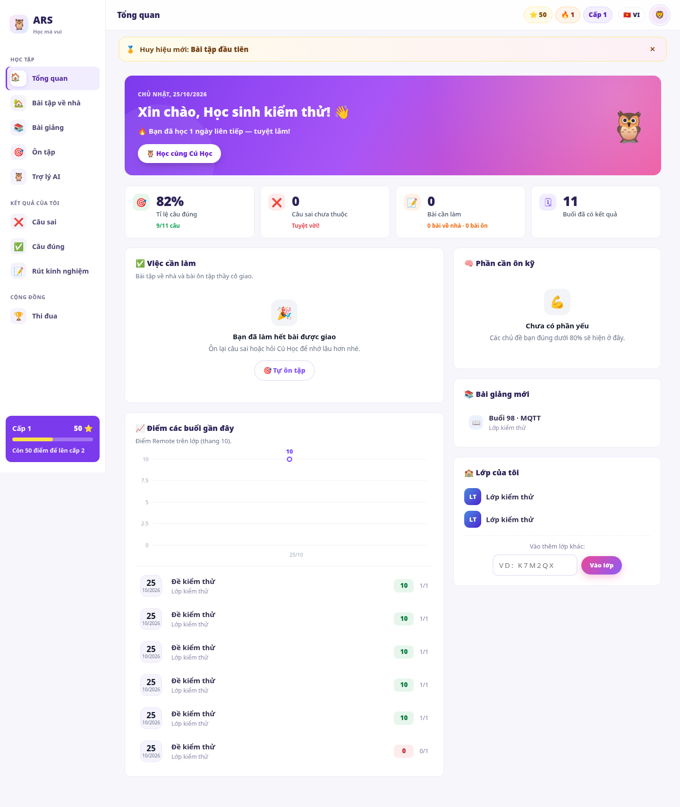
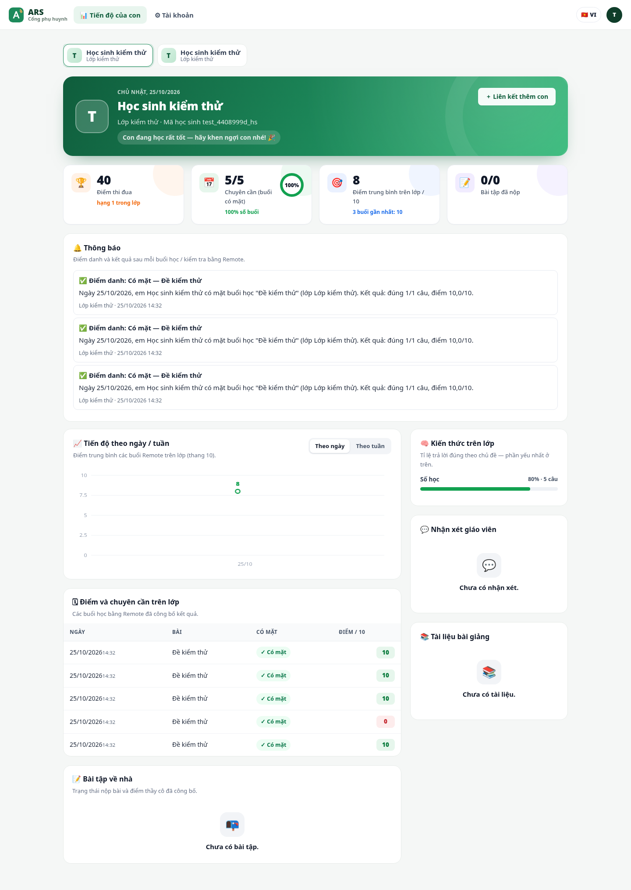
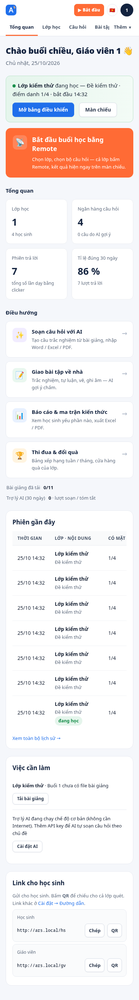
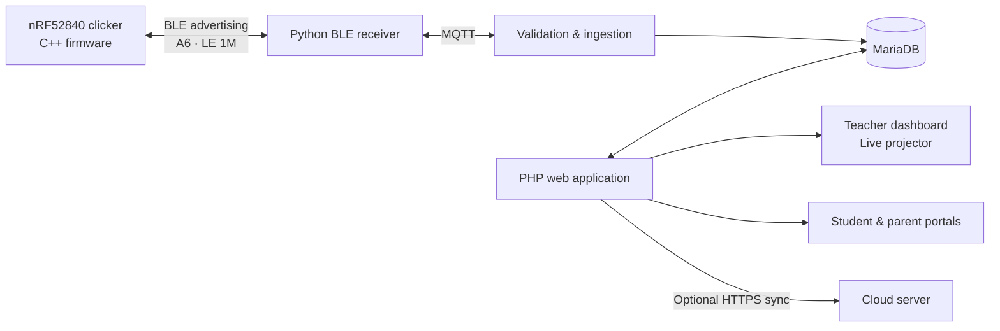
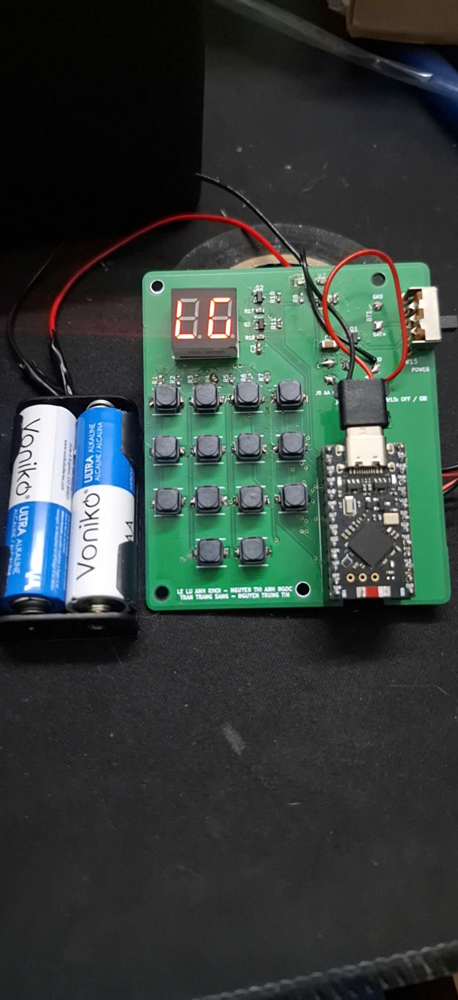

<div align="center">

# ARS · IoT Classroom Response System

**Physical clickers. Live classroom feedback. Learning beyond the classroom.**

An end-to-end audience response system built around nRF52840 remotes, a Bluetooth receiver,
and a web application for teachers, students, and parents.

`nRF52840` · `C++` · `Python` · `BLE` · `MQTT` · `PHP 8` · `MariaDB` · `KiCad`

[Overview](#overview) · [Architecture](#architecture) · [Getting started](#getting-started) · [Documentation](#documentation) · [Team](#team)

</div>

## Overview

Students answer questions with a dedicated remote. A teacher's laptop receives responses over Bluetooth, displays results live, and stores classroom activity locally. Optional cloud synchronization makes published results available to students and parents at home.

| Area | What it does |
| --- | --- |
| **Embedded hardware** | Custom two-layer PCB, nRF52840 SuperMini, 14-key matrix keypad, two-digit display, status LEDs, and AA battery supply. |
| **Remote firmware** | Room and seat selection, attendance, A–J answers, automatic question tracking, retries, and result acknowledgement. |
| **Receiver & ingestion** | Python BLE receiver, MQTT transport, validation, duplicate protection, and transactional answer storage. |
| **Teacher workspace** | Classes, question banks, live sessions, attendance, assignments, analytics, and spreadsheet exports. |
| **Student & parent portals** | Practice, assignment submission, learning progress, attendance, and published results. |
| **Deployment** | Ubuntu installation scripts, systemd services, local operation, and optional cloud synchronization. |

## Interface

The layout keeps the existing blue/orange, purple/pink, and green portal palettes, with clearer spacing, smaller action cards, and responsive navigation.



<details>
<summary>Student, parent, and mobile views</summary>

### Student portal



### Parent portal



### Mobile dashboard



Screenshots use a temporary database with synthetic test accounts and classroom data.

</details>

## Architecture



The remote handles input and radio communication. The ingestion service validates answers and writes them to the database; business rules can therefore change without reflashing every remote.

**Reliability:** transaction tokens and retries prevent duplicate answer records; questions close automatically when their timer expires. Classroom operation runs locally, including when internet access is unavailable. External AI and cloud features require their respective services.

## Hardware

The remote uses a **68 × 80 mm, two-layer PCB**, an **nRF52840 SuperMini**, a matrix keypad, and a two-digit seven-segment display.

| PCB | Assembled remote |
| :---: | :---: |
|  |  |

[KiCad source](hardware/kicad/) · [Prototype Gerbers](hardware/kicad/gerber_prototype/) · [Bill of materials](hardware/BOM_linhkien_nhom2.xlsx) · [Schematic](hardware/images/Schematic.jpg)

## Repository layout

| Directory | Contents |
| --- | --- |
| [`firmware/`](firmware/) | Arduino C++ firmware; active remote version: `ARS_remote_v3_17`. |
| [`hardware/`](hardware/) | KiCad projects, Gerbers, bill of materials, and hardware photos. |
| [`server/`](server/) | Python BLE receiver, MQTT ingestion, and shared configuration. |
| [`web/`](web/) | PHP application, JSON APIs, portal assets, and cloud synchronization. |
| [`database/`](database/) | MariaDB schema and migrations. |
| [`deploy/`](deploy/) | Ubuntu setup, systemd units, upgrades, and rollback scripts. |
| [`tests/`](tests/) | Integration, browser, protocol, and firmware host tests. |
| [`tools/`](tools/) | Radio measurements, packet analysis, and remote simulation. |
| [`docs/`](docs/) | Setup, architecture, operating guides, and project report. |
| [`samples/`](samples/) | Example question sets and import templates. |

## Getting started

### Classroom server · Ubuntu 22.04 / 24.04

Read the [installation guide](docs/HUONG_DAN_CAI_DAT.md) before running the installer. It configures local web, database, MQTT, and system services.

```bash
sudo bash deploy/install_ubuntu.sh

# Upgrade the transport stack in order; scripts include backup / rollback support.
sudo bash deploy/install_gatt.sh
sudo bash deploy/install_adv16.sh
sudo bash deploy/update_adv17.sh
sudo bash deploy/update_adv18.sh
```

Open **http://ars.local/gv** after setup. Use `config.ini.example` as the configuration reference.

### Remote firmware

Open `firmware/ARS_remote_v3_17/ARS_remote_v3_17.ino` in Arduino IDE with the Adafruit nRF52 board package. See the [technical guide](docs/KY_THUAT_CHI_TIET.md) for the protocol and hardware details.

### Optional cloud server

```bash
sudo bash deploy/install_ubuntu.sh --cloud
```

Continue with the [cloud deployment guide](docs/HUONG_DAN_CLOUD.md).

## Verification

| Check | Command |
| --- | --- |
| Web, database, and cloud integration | `bash tests/run_local.sh` |
| Responsive browser layouts | `node tests/layout_smoke.cjs /path/to/smoke.json` |
| Browser interactions: math, canvas, assignment submission | `node tests/ui_smoke.cjs /path/to/smoke.json` |
| BLE advertising protocol | `python3 tests/adv_unit.py` |
| LE 1M configuration and traces | `python3 tests/adv18_unit.py` |
| Firmware host simulation | `bash tests/adv_firmware_host/run.sh` |

The web suite creates a disposable MariaDB instance and synthetic data. See [`tests/README.md`](tests/README.md) for dependencies and browser setup, and [layout verification notes](docs/UI_LAYOUT.md) for this revision's results.

**Hardware measurement limit:** recorded radio measurements cover one physical remote. Simultaneous radio traffic from a full classroom has not been validated.

## Documentation

- [New user guide](docs/HUONG_DAN_NGUOI_MOI.md)
- [User guides by role](docs/huong-dan-su-dung/README.md)
- [Installation](docs/HUONG_DAN_CAI_DAT.md) and [cloud deployment](docs/HUONG_DAN_CLOUD.md)
- [Technical architecture](docs/KY_THUAT_CHI_TIET.md) and [project overview](docs/TONG_HOP_DU_AN.md)
- [Project report](docs/bao-cao/Bao_cao_IOT_nhom2.docx)

## Team

| Member | Student ID |
| --- | --- |
| Nguyễn Thị Ánh Ngọc | 23134040 |
| Lê Lữ Anh Khôi | 23134033 |
| Trần Trăng Sáng | 23134050 |
| Nguyễn Trung Tín | 23134055 |
